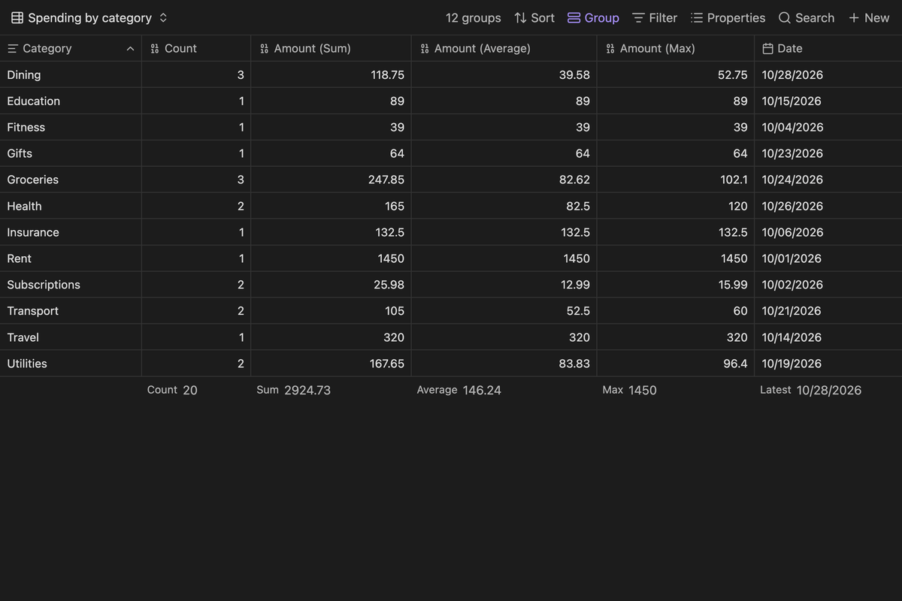
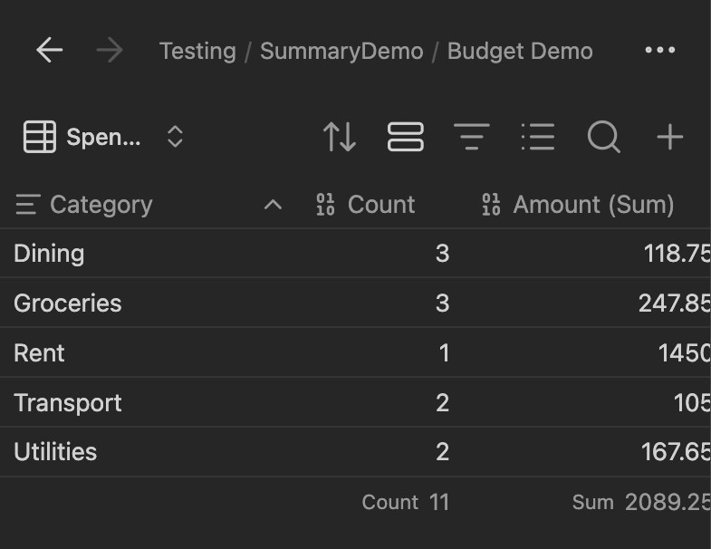
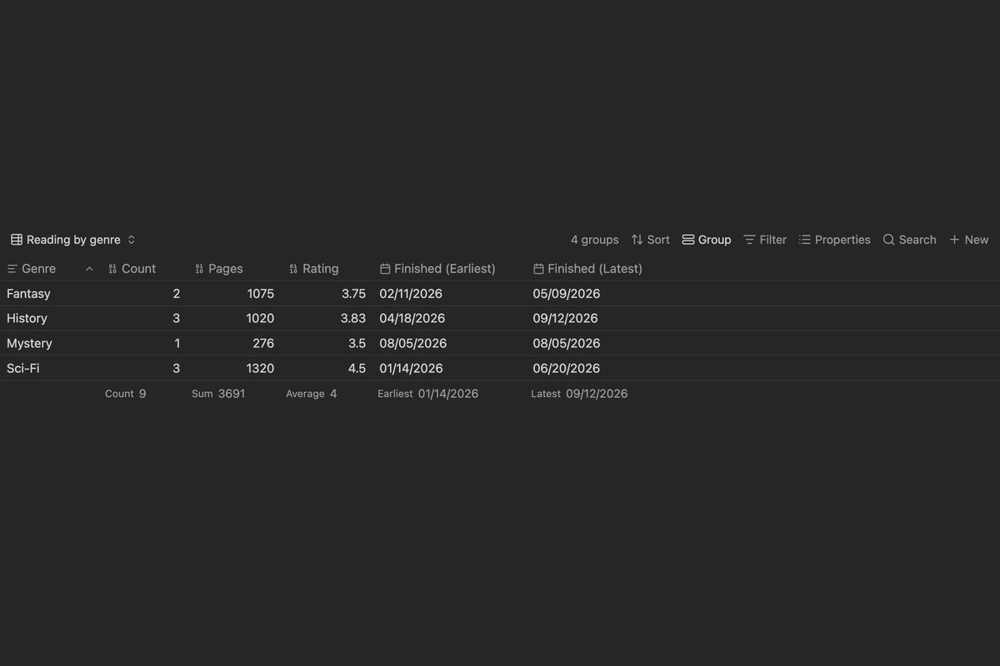
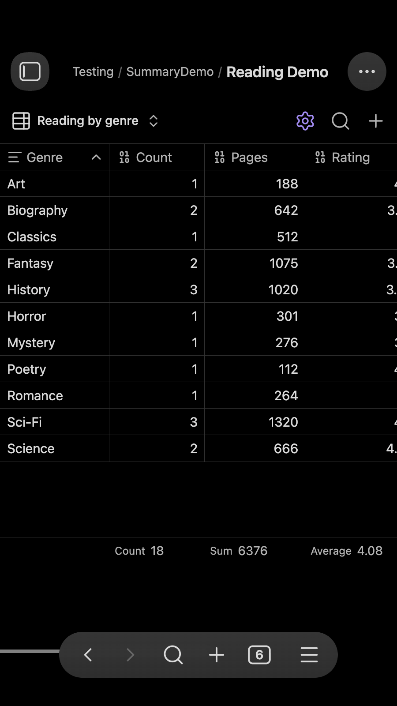
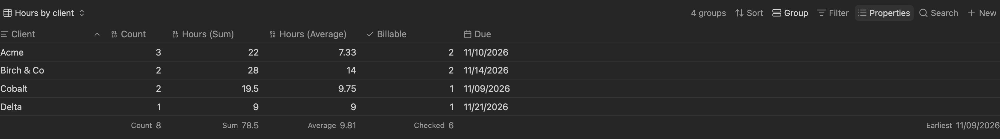
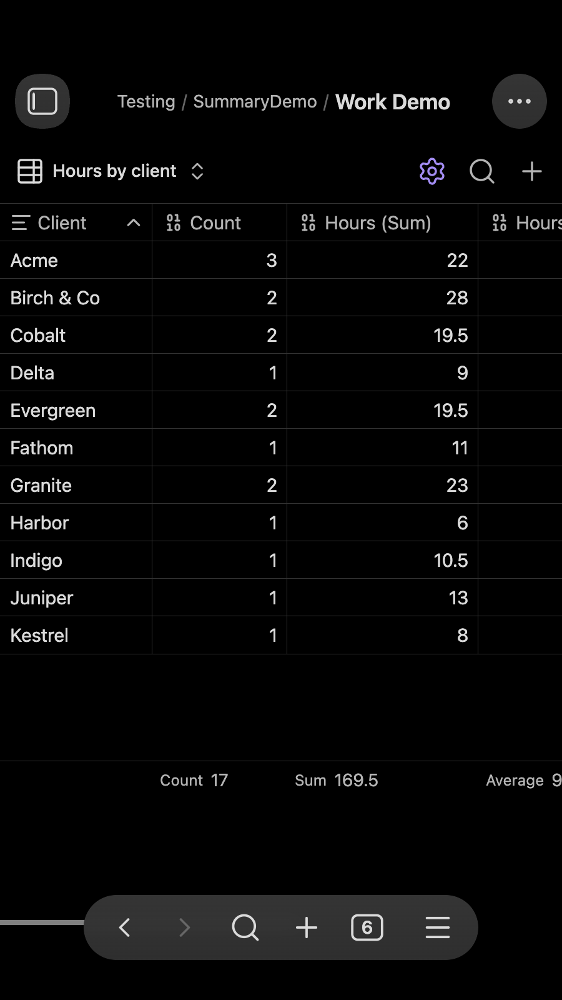
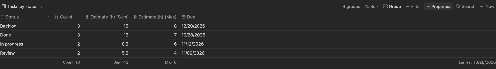
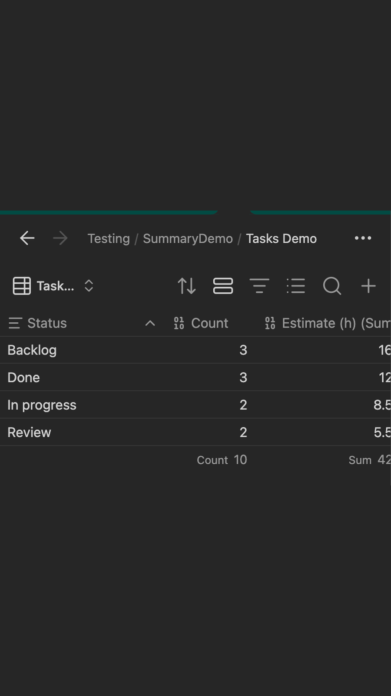

# Simple Summary Base View

This plugin renders a grouped summary table as a custom [Obsidian Bases](https://help.obsidian.md/bases) view.

Create a Base, filter the notes you want, group by a property, and select the `Simple Summary Base View` custom view. You get one row per group, with a note count and any summaries you choose, styled like the native Bases table.

## How to use

### 1. Create a Base and select the custom view

Example `.base` file:

```yaml
filters:
  and:
    - file.inFolder("Media")
views:
  - type: summary-base-view
    name: Summary
    groupBy:
      property: note.media
      direction: ASC
    order:
      - amount
      - released
    summaryColumns:
      - type: count
      - property: note.amount
        summary: Sum
      - property: note.amount
        summary: Average
      - property: note.released
        summary: Earliest
```

View settings:

- `groupBy`: the property to group by, edited with the Base's Group menu
- `order`: the properties that get summary columns, edited with the Base's Properties menu
- `sort`: header sorting, edited with the Base's Sort menu
- `summaryColumns`: the list of summary columns. Use `type: count` for the note count, or a `property` with a `summary`
- `columnSize`: saved column widths

### 2. Add and remove summary columns

- Right-click a column header and choose **Add summary column** to summarize the same property a second way, such as Sum and Average of `amount`.
- Right-click a header and choose **Remove column** to remove any column, including Count. Use the group header menu to add Count back.
- Click a footer cell to choose a native summary (Sum, Average, Earliest, Unique, and so on).
- Choose **Add summary** in that picker to write your own formula. The formula editor suggests `values` methods (`sum()`, `mean()`, `filter()`, ...), chained helpers such as `round()`, and the built-in summaries as you type. The result is saved as a custom summary in the Base and can be reused.
- Summaries respect the property type. A date-only property stays date-only for Earliest and Latest.

### 3. Sort, resize, and export

- Click a header, including the group header, to sort. The Base's Sort and Group menus reflect the change.
- Drag the edge of a header to resize a column.
- Use the results button to copy the summary to the clipboard or export it as CSV.

## Settings

- **Excluded folders**: notes in these folders are left out of group counts and summaries. The default is `Templates`. Enter one folder name per line. A name matches a folder with that name anywhere. A path such as `Archive/Old` matches that folder and its subfolders. Leave it empty to include everything.

## Screenshots

Captured from small demo Bases in Obsidian's default theme. Each example shows desktop, then phone width.

### Budget: spending by category (Count, Sum, Average, Max, Latest date)





### Reading log: pages and ratings by genre





### Project hours: billable hours by client





### Tasks: estimates and earliest due date by status






## Quick compile and test

```bash
npm run verify
```

That command builds the plugin, type-checks it, runs the Obsidian community scanner lint, and runs a smoke test against the summary core.

## Support

If this plugin is useful to you, you can support its development on [Ko-fi](https://ko-fi.com/jarbochov).
